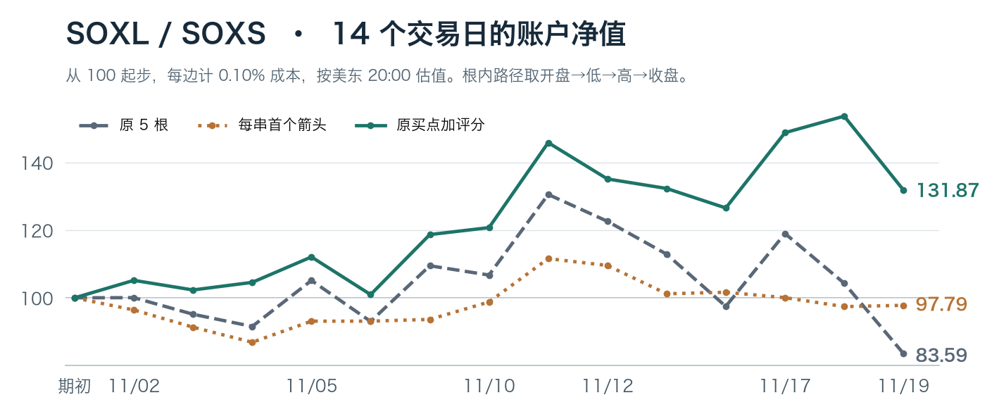

# SOXL / SOXS 买入过滤实验

11 月 2–19 日，在原 179 个买点上逐笔决定买或跳过，冻结的评分门槛拦掉 49 笔亏损、25 笔盈利，保留 42 笔盈利、62 笔亏损和 1 笔期末持仓。按相同 ETF、交易日和时段随机留下同样数量的原买点，平均会留下 64 笔亏损。当前规则比这个对照少亏 2 笔。



## 原买点加评分

在后台按原 5 根规则记录每一个本应发生的买卖，即便模型选择空仓，也持续记录原策略的持仓状态。只有原策略下一次新买入时才重新评分。输入为本股 25 和 60 分钟的涨幅和有序回撤、60 分钟收盘路径效率、当前收盘在该小时高低区间内的位置，以及反向 ETF 的 25 分钟涨幅。逻辑回归使用 7 月 27 日至 8 月 14 日的 133 个已平且可评分的原买点拟合。

按 8 月 17–28 日校准数据的分数分位数设三个阈值，依据该期亏损率和笔数约束选中中位数档。分数达到 0.293756 才放行。这里的分数用于排序，未验证其数值是未来净盈利概率。买入时间、资金占用和每笔退出可逐一与原账本对上。

| 11/2–19 规则 | 买入 | 盈 / 亏 / 未平 | 拦掉的原亏损 / 原盈利 | 亏损率¹ | +8% 止盈 | 主路径净收益 | 另一根内顺序净收益 | 主路径最大回撤² |
|---|---:|---:|---:|---:|---:|---:|---:|---:|
| 原策略 | 179 | 67 / 111 / 1 | 0 / 0 | 62.4% | 17 | -16.41% | -48.27% | 38.31% |
| 中位数门槛（冻结） | 105 | 42 / 62 / 1 | 49 / 25 | 59.6% | 13 | +31.87% | +2.28% | 19.81% |
| 第75百分位门槛 | 57 | 22 / 34 / 1 | 77 / 45 | 60.7% | 7 | +12.39% | -11.75% | 19.81% |
| 第90百分位门槛 | 39 | 15 / 23 / 1 | 88 / 52 | 60.5% | 4 | +6.87% | -13.72% | 11.78% |

¹ 分母为已平仓。² 按 5 分钟收盘估值。两路径分别为开→低→高→收和开→高→低→收；两者各自允许止损实时上移。买卖各计 0.10% 成本，全资金、可复用、不限日次数。期末浮盈亏计入收益。该研究假设全时段触及即成交。

## 同一冻结规则换到其他日期

| 时段（每段独立空仓起步） | 原亏损 / 已平 | 新亏损 / 已平 | 原净收益 | 新净收益 | 另一顺序原 / 新净收益 |
|---|---:|---:|---:|---:|---:|
| 8/17–28 校准 | 32 / 48 | 16 / 23 | -26.81% | -21.27% | -32.26% / -26.13% |
| 9/14–18 未用于选模 | 7 / 13 | 5 / 8 | +16.38% | +0.99% | +11.28% / +0.88% |
| 10/26–30 补充检查 | 23 / 33 | 13 / 17 | -0.59% | -9.84% | +7.28% / -2.71% |
| 11/2–19 已暴露历史 | 111 / 178 | 62 / 104 | -16.41% | +31.87% | -48.27% / +2.28% |
| 11/16–19（包含在上一行） | 41 / 60 | 24 / 35 | -21.08% | -0.33% | -33.19% / -7.34% |

只用最后四天时，亏损交易从 41 笔降到 24 笔，但占已平仓的比例从 68.3% 变成 68.6%。9 月和 10 月的检查周也出现买得更少、亏损占比更高的情况。

## 图上的确认点与实际下单

页面当前默认按 60–2880 分钟 5m 收盘走势寻找已涨至少 5%、最大收盘回撤至多 3% 的区间，并排除 30 分钟内贡献超过半数净对数涨幅的急拉。11 月两只 ETF 各 4,032 根，SOXL 有 112 个上行确认点，SOXS 有 116 个。它们分别集中为 55 和 42 串连续确认。页上默认可以回看整段背景，算法在箭头确认并可见后才能使用该信号。

11 月 4 日 SOXL 从 01:00 的 73.62 涨到 05:20 的 77.55，图上确认时已涨 5.34%。按箭头买的版本在 05:25 以 77.60 入场，06:30–06:35 的 5 分钟柱在 76.727 触发移动止损，两边扣费后亏 1.32%。

| 原 5 根 + 附加条件 | 买入 | 盈 / 亏 / 未平 | 直接拦掉原亏损 / 原盈利³ | 组合净收益 | 另一顺序净收益 |
|---|---:|---:|---:|---:|---:|
| 原 5 根 | 179 | 67 / 111 / 1 | 0 / 0 | -16.41% | -48.27% |
| 最近一小时持续走强 | 168 | 62 / 105 / 1 | 48 / 29 | -33.13% | -59.90% |
| 持续走强，回踩后收复前一根高点 | 138 | 46 / 92 / 0 | 71 / 48 | -23.51% | -52.16% |
| 再突破前三根高点，与反向 ETF 相互确认 | 131 | 42 / 89 / 0 | 73 / 49 | -30.25% | -50.76% |
| 再要求一小时有序回撤小于 1.5% | 47 | 15 / 32 / 0 | 102 / 63 | -13.99% | -18.40% |
| 过去一小时有图表确认 | 40 | 13 / 27 / 0 | 107 / 62 | -13.30% | -21.69% |
| 当前这根有图表确认 | 30 | 10 / 20 / 0 | 110 / 65 | -2.07% | -11.33% |
| 当前有确认，前半小时无确认（第一轮选中） | 29 | 9 / 20 / 0 | 111 / 67 | -2.21% | -11.45% |
| 确认后回踩，再收复前一根高点 | 20 | 7 / 13 / 0 | 109 / 66 | -1.28% | -3.39% |

³ 这些版本会在空出资金后重新检查并买入，直接拦掉的原交易和实际组合盈利/亏损不能做简单减法。每串首个确认对应的 29 笔全部是新时点，损失 20 笔；原版扣费亏损率为 62.4%，该版为 69.0%。

## 同笔数随机保留

在原始互斥账本中均匀抽 105 笔，平均留下 65.11 笔亏损。进一步匹配 ETF、交易日、时段及每组保留笔数后，平均为 64 笔，随机得到 62 笔或更少亏损的概率为 23.62%。分层随机组合净收益中位数为 +21.27%，实际 +31.87% 位于第 76.2 百分位。该对照中有 55 笔由所匹配的分组笔数唯一确定。亏损笔数的分布为精确计算，收益分位来自 50,000 次无放回抽样。

## 复跑和逐笔检查

在本目录依次运行以下命令。检查器的两份 JavaScript 源文件存在时，脚本使用页面原逻辑重算箭头并验证结果；在其他工作副本中，已归档的确认时间可供相同输入指纹复算。

```sh
/opt/homebrew/bin/python3.14 study.py develop
/opt/homebrew/bin/python3.14 study.py evaluate
/opt/homebrew/bin/python3.14 check.py
/opt/homebrew/bin/python3.14 shadow_score.py freeze
/opt/homebrew/bin/python3.14 shadow_score.py evaluate
/opt/homebrew/bin/python3.14 check.py --ledger shadow_ledger.json --output shadow_check.json
/opt/homebrew/bin/python3.14 shadow_control.py
```

[图表过滤协议](PROTOCOL.md) · [原买点否决协议](SHADOW_PROTOCOL.md) · [冻结模型和阈值](shadow_freeze.json) · [179 个买点的逐笔特征、分数与放行结果](shadow_decisions.json) · [原买点与放行账本](shadow_ledger.json) · [逐日、逐股与各时段的结果](shadow_results.json) · [随机拦单对照](shadow_random.json)
