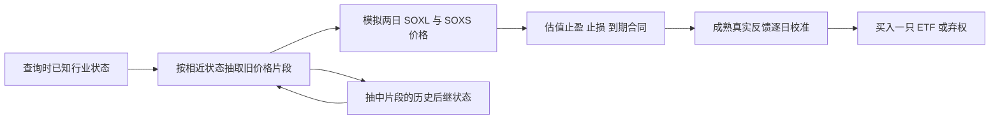

# v62 · 行业状态随联合价格路径转移

**未通过开发筛选。** 一至四月净月收益均值 −2.20%，一月与三月为负。动态状态综合预测误差比保持当前状态高约 8.45%，本轮没有新的指定月份资金回归。31 项测试与全部独立回放核验通过，原收益目标尚未完成。

本版检验“从当时可见的行业环境出发，模拟热度变化是否改善原十四日交易收益”。前版整个持有窗口始终使用查询时的行业状态。本版每抽取两日价格片段，转到该片段实际历史的后继行业状态，再选择下一段价格。所有源价格和后继状态必须在本次每日训练截止前可知。

算法是条件核加权的局部经验状态转移、SOXL／SOXS 联合两日价格路径，以及重复扰动 Sobol 积分。收益校准仍是按时点部分共享的 Ridge 残差回归与日期块重抽样，分别使用各模型自己当时发出的历史预测与成熟的十四日真实结果。



图中的后继状态属于模拟情景；真实未来状态只在事后诊断中使用。

## 固定研究设计

- 状态为行业相对五日强弱、八只参考公司上涨广度、行业波动率对数；第一段额外按当时行业价格前缀匹配。固定参考公司池不是历史完整行业成分池。
- 每个两日源片段保留下一官方交易日 09:25:30 ET 的三个后继状态值，并保守地将该记录时间作为可用时间。后继状态未知保持缺失；不得用未来补齐值改写较早预测。
- 三条路线共用后继状态完备的样本池。主模型 `conditional` 每两日转到抽中片段的历史后继状态；`fixed` 始终使用查询时状态；`unconditional` 只用历史时间权重。三个模型的随机均匀点、路径数量、交易规则和校准规则相同。
- 源片段必须是连续两个完整官方常规盘，沿用 126 个合格日期半衰期、标准化高斯核、正距离 40% 分位数带宽、至少 120 个真实片段和有效样本数至少 20。所有可能后继状态的转移行均满足有效样本数要求，三路线才具备共同就绪资格。
- 共 2,048 条联合路径，八组独立扰动 Sobol、每组 256 点，固定日期／时点种子、正式 replication=0。标准误来自八组均值间的方差，描述计算误差，不是市场风险区间，也不增加真实日期样本数。
- 实际动作仍为买一只 ETF 或弃权。按同一规则附带 +5% 止盈、固定 6% 保护止损；含入场日最多十四个日历日，截止内最后官方收盘退出。同根双触及时止损优先，保留不利跳空、费用滑点、T+1、拆股、分红支付、单一持仓、当日禁止再入场、跨月盯市和未知占资。

每个后继状态的转移概率按其与历史起点状态的距离重新计算。它假设相近状态具有可转移的后继分布；不保证模拟行业统计能由缩放后的 ETF 价格严格反算。状态向量是否足够、历史是否平稳、目标半日市截取完整源日前缀的迁移假设均未获证明。方法背景见 [Pan 与 Politis 的作者稿](https://mathweb.ucsd.edu/~politis/PAPER/MarkovREVjune2015.pdf)，其理论条件不能自动视作本市场成立。

## 验收顺序

先通过合同、缺失／未来信息排除、状态链和独立方程测试，核验全部源价格与后继状态。再对固定 2025-11-12、2026-01-05、2026-04-01 的八时点执行独立路径估值及本版历史校准预检，之后冻结所有源码、参数和输入，再计算开发资金结果。

开发主路线必须一至四月每月非负、月均至少 10%、至少十笔完成交易且覆盖完整，经完整独立核验后才允许新五月至九月资金回归。对照不替代失败主路线。用户最终目标保持：五／七／九月完整资金净月收益算术均值至少 10%，五月至九月每月非负；不按指定月份拟合，不增加未来观察期门槛。已暴露历史仍称开发回归。

同时在结果完整后检查：从查询时预测两交易日之后的行业状态，是否优于保持当前状态；末端未知目标保留。状态预测较准、方向 Brier 较低和资金收益通过分别报告。

## 运行

```bash
PY=.cache/soxl_soxs_14d5pct_v2/venv/bin/python
OMP_NUM_THREADS=1 OPENBLAS_NUM_THREADS=1 $PY -W error -m unittest discover -s research/soxl_soxs_14d5pct_v62 -p 'test_*.py'
# 核验登记哈希后，使用一个尚不存在的输出目录。
OMP_NUM_THREADS=1 OPENBLAS_NUM_THREADS=1 $PY -W error research/soxl_soxs_14d5pct_v62/run_paths.py --output .cache/soxl_soxs_14d5pct_v62/runs/NEW_RUN
OMP_NUM_THREADS=1 OPENBLAS_NUM_THREADS=1 $PY -W error research/soxl_soxs_14d5pct_v62/verify_paths.py --run .cache/soxl_soxs_14d5pct_v62/runs/NEW_RUN
```

行情、模型数组和逐次运行位于忽略的 `.cache`，不进入 Git；没有新数据下载、R2 上传或券商订单。八个固定研究时点覆盖盘前，v4 任意时刻接口仍不因本研究自动获得有效性资格。

开发回放与独立核验完成，主路线未通过开发收益筛选。

## 完整开发结果

动态状态主路线一至四月净月收益算术均值 **-2.20%**，开发筛选**未通过**。没有新的五月至九月资金回归；原指定月份目标仍未完成。

| 月份 | 动态状态 | 同样本固定状态 |
| --- | ---: | ---: |
| 2026-01 | -11.36% | -5.55% |
| 2026-02 | +0.58% | +10.77% |
| 2026-03 | -5.50% | -1.64% |
| 2026-04 | +7.49% | +3.22% |

主路线实际模拟买入 27 次，完成 27 次、待定 0 次；止盈 15 次、止损 12 次、到期 0 次。连续净收益 -9.44%，最大收盘回撤 -24.08%。月度数据来自完整资金与跨月盯市，单笔收益百分比没有直接相加。

| 路线 | 开发月均 | 所有月非负 | 完成交易 |
| --- | ---: | --- | ---: |
| conditional_band | -2.20% | 否 | 27 |
| conditional_point | +3.56% | 否 | 47 |
| unconditional_band | -13.49% | 否 | 23 |
| fixed_band | +1.70% | 否 | 31 |
| source_v56 | +5.04% | 否 | 20 |
| source_v55 | +3.78% | 否 | 26 |
| premarket_only | -1.28% | 否 | 16 |
| cash | +0.00% | 是 | 0 |
| double_cost | -2.90% | 否 | 27 |

动态、固定、无条件三模型共享后继状态完备池和随机点；前两者的差异来自未来片段权重随状态变化及各自的逐日校准。其他对照保留原名称与口径，没有事后更换主路线。

| 两交易日后状态 MSE（日期等权） | 动态状态预测 | 保持当前状态 |
| --- | ---: | ---: |
| 行业相对五日强弱 | 0.457638 | 0.401250 |
| 上涨广度 | 0.316782 | 0.406250 |
| 行业波动率对数 | 0.028045 | 0.004721 |
| 用历史尺度标准化后均值 | 0.710538 | 0.655150 |

状态诊断覆盖 640 个已知目标、80 个真实日期，另保留 16 个未知；同日八时点按日期等权，不能当作八个独立市场日。状态预测准确与收益通过分别判断。

| 原十四日收益诊断 | 动态 | 固定 | 无条件 |
| --- | ---: | ---: | ---: |
| 原始对数收益 MSE | 0.004279 | 0.004292 | 0.004271 |
| 校准后对数收益 MSE | 0.004444 | 0.004406 | 0.004446 |
| 收益差方向 Brier | 0.248086 | 0.249006 | 0.247882 |

完整核验覆盖 2913 个查询、22,990,848 个模拟合同、208,800 个独立校准等式、九个资金账本和 153 项统计；旧 v56／v55 的八份 CSV 逐字节一致。31 项测试通过；三个固定日期共 24 个真实查询 ×3 个模型的预测和校准预检通过，2,048 与 8,192 两档路径均独立估值。所有正式预测的种子、replication=0、转移权重、源样本可用时间和费用／退出均已核验。

失败开发门禁通过实际 CLI 调用核对，拒绝新指定月份回放且没有创建输出目录。没有修改原始行情、旧研究或风险门槛，没有新数据下载、自动 R2 上传或券商订单。

[结果](evidence/results.json) · [完整核验](evidence/verification.json) · [收益诊断](evidence/diagnostics.json) · [状态诊断](evidence/state_diagnostics.json) · [状态诊断核验](evidence/state_diagnostics_audit.json) · [交付清单](evidence/delivery_manifest.json)。

匹配路径进一步核对：SOXL、SOXS 通过首个两日片段后仍未退出的比例分别为 33.23%、34.77%。此前已经退出的 1,773,438 个合同在两模型中的对数收益逐值完全相同；后续状态转移仅能影响继续持有的部分。这是模拟路径诊断，不是实际交易胜率。[机制检查](evidence/path_effect.json)。

下一步优先检验入场时行业绝对涨跌是否为首段路径提供增量。结果后输入检查确认，原有 2,452 个就绪查询全部具有 `sector_5`，其中 152 个查询、19 个日期为相对强但绝对下跌。这只证明字段可用及两个概念确有差别，尚未训练或验证新收益模型。旧监督模型已经使用该字段，候选变化是让它直接参与首段价格匹配；详见[下一步草案](NEXT_HYPOTHESIS.md)与[只读输入核查](evidence/entry_state_input_audit.json)。
